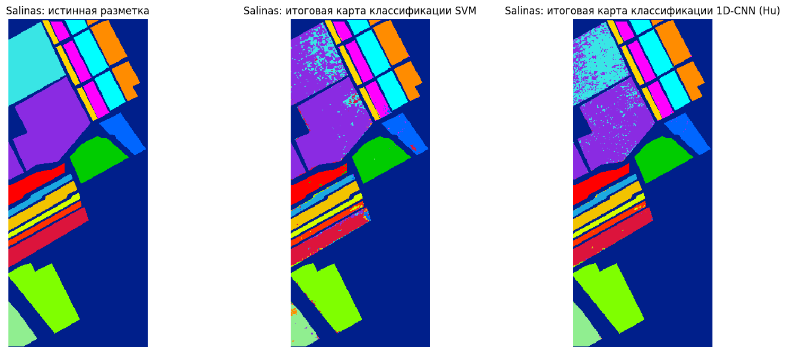
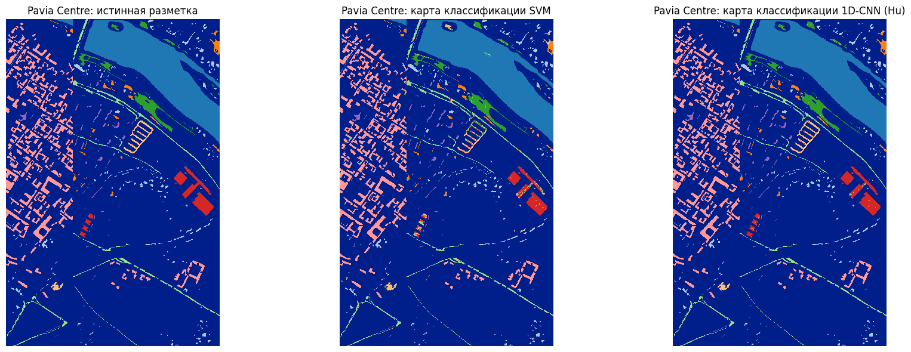

# Hyperspectral Image Classification

Bachelor's thesis research project on **pixel-wise classification of hyperspectral images** using classical machine learning and deep learning.

The project compares spectral and spatial-spectral approaches on the **Salinas Valley** and **Pavia Centre** benchmark datasets.

## What is implemented

- preprocessing of hyperspectral cubes and labeled pixels;
- reproducible train / validation / holdout-test splits;
- spectral **SVM** with standardization and PCA;
- spectral **1D-CNN** implemented in PyTorch;
- experimental **3-2D BERT / D2BERT** with local spatial-spectral patches;
- OA, macro-F1, weighted-F1 and per-class F1 evaluation;
- full-scene classification maps;
- model and metric artifact export.

## Main results

Metrics below are taken from the saved execution included in the notebook.

| Dataset | Model | Training share* | OA | Macro-F1 | Weighted-F1 |
|---|---|---:|---:|---:|---:|
| Salinas Valley | SVM | 30% | 0.8628 | 0.9081 | 0.8434 |
| Salinas Valley | 1D-CNN (Hu) | 10% | **0.9475** | **0.9717** | **0.9466** |
| Salinas Valley | 3-2D BERT / D2BERT | 10% | 0.8882 | 0.9320 | 0.8843 |
| Pavia Centre | SVM | 30% | 0.9690 | 0.8967 | 0.9687 |
| Pavia Centre | 1D-CNN (Hu) | 10% | **0.9917** | **0.9735** | **0.9917** |
| Pavia Centre | 3-2D BERT / D2BERT | 10% | 0.9324 | 0.7671 | 0.9275 |

\* Training share is shown at the top-level train/test split used by each model family. Validation is taken from the development portion where applicable.

The key result of the experiment is that the spectral 1D-CNN achieved strong classification quality while using a smaller labeled training fraction than the SVM baseline.

## Classification maps

### Salinas Valley



### Pavia Centre



## Repository structure

```text
.
├── hyperspectral_classification.ipynb
├── README.md
├── requirements.txt
├── data/
│   └── README.md
├── results/
│   └── summary_metrics.csv
└── assets/
    ├── salinas_classification_maps.png
    └── pavia_classification_maps.png
```

## Setup

Recommended Python version: **3.12**.

```bash
python -m venv .venv
```

Windows:

```bash
.venv\Scripts\activate
```

Linux / macOS:

```bash
source .venv/bin/activate
```

Install dependencies:

```bash
pip install -r requirements.txt
```

Then place the dataset files into `data/` and start Jupyter:

```bash
jupyter notebook
```

Open `hyperspectral_classification.ipynb` and run the cells in order.

## Notes on reproducibility

- `RANDOM_STATE = 42` is used for deterministic data splitting where supported.
- Dataset files and trained weights are excluded from Git through `.gitignore`.
- The notebook contains saved outputs so the reported experiment can be reviewed directly on GitHub.
- The active final 1D-CNN configuration is Hu-style; other literature-inspired 1D-CNN classes are retained in the notebook as experimental implementations.

## Thesis

The code was developed as part of the bachelor's thesis:

**“Development of a deep learning model for pattern recognition based on hyperspectral soil images”**  
Peter the Great St. Petersburg Polytechnic University, 2026.
